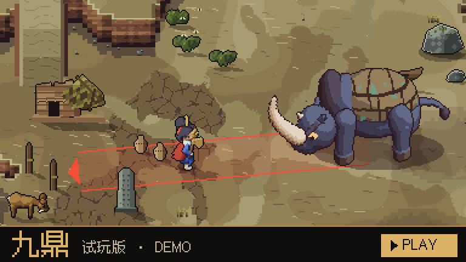

# JIUDING 九鼎 (Demo)

Play in the browser: https://aslanding.github.io/jiuding/

A hunter of the Xia, sent out by Yu the Great after the strange beasts of the Classic of Mountains and Seas: track them, break their horns and shells, take them alive or kill them, and cast their likeness on a bronze cauldron. This demo is the first province, Yuzhou.

- Three beasts, each a five-to-ten-minute fight with stages and parts to break
- Axe, dagger-axe, bow and bronze drum, forged from what you carve
- Requests, patrols, steles to rub, and Yuzhou's cauldron to cast

In Chinese for now. Plays in the browser with a keyboard and mouse; saves stay in this browser.

This repository holds the Godot 4 web build that GitHub Pages serves. More of my work: https://aslanding.github.io/others/
